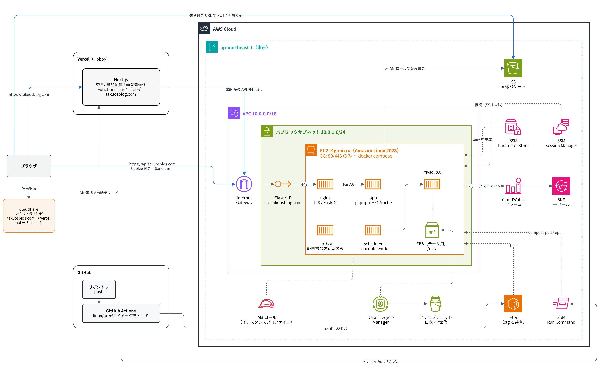

# インフラ構成図

フロントエンド（Next.js）を Vercel、バックエンド（Laravel + MySQL）を AWS の EC2 1台に置く構成です。
決めた理由や各設定の詳細は [design.md](./design.md) にまとめています。

## 目次

- [全体図](#全体図)
- [リクエストの流れ](#リクエストの流れ)
- [デプロイの流れ](#デプロイの流れ)
- [ドメイン](#ドメイン)
- [アイコン](#アイコン)

---

## 全体図

構成図は draw.io 形式の [architecture.drawio](./architecture.drawio) です。draw.io（デスクトップ版・VS Code 拡張・diagrams.net）で開いて編集します。

GitHub は `.drawio` を図として表示しないので、本番のページを PNG（[architecture-prod.png](./architecture-prod.png)）に書き出して README とこのページに載せています。**図を直したら PNG も書き出し直してください**（draw.io で「本番」のページを開き、ファイル → エクスポート → PNG。倍率 200%、背景は白）。

| ページ | 内容 |
| --- | --- |
| 本番 | 常に動かす本番環境 |
| ステージング | 必要なときだけ作る確認用の環境と、本番と共有するもの（ECR・Parameter Store） |

図の見方：

- 青い実線：利用者からのリクエスト
- 灰色の実線：AWS 内部の通信とデプロイ
- 点線：管理系（イメージの取得・秘密情報・接続・監視・バックアップ）

---

## リクエストの流れ

| 種類 | 経路 | 認証 |
| --- | --- | --- |
| ページ表示（SSR） | ブラウザ → Vercel → `api.takuosblog.com`（公開記事の取得） | なし |
| ログイン・いいね・記事管理 | ブラウザ → `api.takuosblog.com` に直接 | Sanctum の SPA Cookie 認証 |
| 画像アップロード | ブラウザ → S3（Laravel が発行した署名付き URL へ PUT） | 署名付き URL |
| 画像表示 | ブラウザ → S3（または Vercel の画像最適化経由） | なし（公開読み取り） |

---

## デプロイの流れ

| 対象 | 流れ |
| --- | --- |
| フロントエンド | GitHub に push → Vercel が Git 連携で自動ビルド・デプロイ |
| バックエンド | GitHub Actions で `linux/arm64` イメージをビルド → ECR へ push → SSM Run Command で EC2 に `docker compose pull && up -d` を実行させる |

GitHub Actions から AWS へは OIDC で認証します（長期のアクセスキーは使いません）。

---

## ドメイン

ドメインは Cloudflare で取得した `takuosblog.com` を使います。DNS も Cloudflare で管理します（[design.md の DNS](./design.md#dnscloudflare)）。

| ホスト名 | 向き先 | 用途 |
| --- | --- | --- |
| `takuosblog.com` | Vercel | フロントエンド |
| `api.takuosblog.com` | EC2 の Elastic IP | Laravel API |
| `stg.takuosblog.com` | Vercel（`develop` ブランチ） | ステージングのフロントエンド |
| `api.stg.takuosblog.com` | ステージングの EC2 のパブリック IP（apply のたびに登録） | ステージングの Laravel API |

Sanctum の Cookie 認証を使うため、2つは**同じ親ドメインの下に置く必要があります**（[design.md の認証](./design.md#認証とcors)）。

---

## アイコン

`images/` には、構成図で使っている [AWS Architecture Icons](https://aws.amazon.com/architecture/icons/)（2026年1月版）の SVG だけを置いています。
`architecture.drawio` にはこれらの SVG を埋め込んでいるので、`images/` が無くても図は表示されます。アイコンを差し替えるときは、`images/` も合わせて更新してください。
